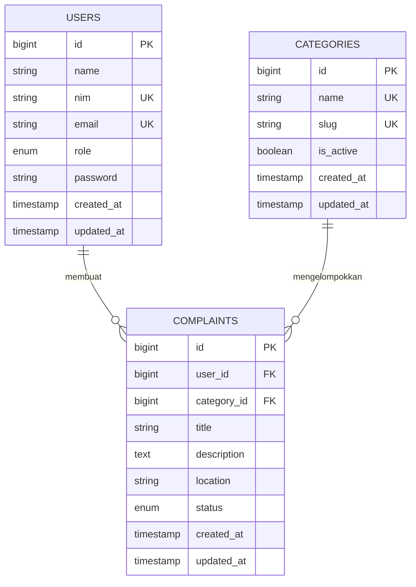

# ERD dan Kamus Data

## ERD



## Kamus Data

| Tabel | Kolom | Keterangan | Constraint |
|---|---|---|---|
| `users` | `id` | Primary key akun | PK, auto increment |
| `users` | `name` | Nama mahasiswa/admin | Wajib, maks. 255 karakter |
| `users` | `nim` | Nomor induk mahasiswa | Unique, nullable untuk admin |
| `users` | `email` | Email akun | Unique |
| `users` | `role` | Hak akses akun | `student` atau `admin`, default `student` |
| `users` | `password` | Password yang di-hash | Wajib |
| `categories` | `id` | Primary key kategori | PK, auto increment |
| `categories` | `name` | Nama kategori pengaduan | Unique, maks. 80 karakter |
| `categories` | `slug` | Identitas kategori untuk URL/query | Unique |
| `categories` | `is_active` | Ketersediaan kategori | Boolean, default `true` |
| `complaints` | `id` | Primary key pengaduan | PK, auto increment |
| `complaints` | `user_id` | Pemilik/pelapor pengaduan | FK ke `users.id`, `NULL` saat user dihapus |
| `complaints` | `category_id` | Kategori pengaduan | FK ke `categories.id`, hapus kategori ditolak saat masih dipakai |
| `complaints` | `title` | Ringkasan pengaduan | Wajib, 5–140 karakter |
| `complaints` | `description` | Detail pengaduan | Wajib, 10–3000 karakter |
| `complaints` | `location` | Lokasi kejadian | Opsional, maks. 180 karakter |
| `complaints` | `status` | Status tindak lanjut | `Menunggu`, `Diproses`, `Selesai`, atau `Ditolak` |

Relasi: satu user dapat memiliki banyak pengaduan (`hasMany`), satu kategori mengelompokkan banyak pengaduan (`hasMany`), dan setiap pengaduan dimiliki satu user serta satu kategori (`belongsTo`).

## Matriks Hak Akses

| Aksi | Mahasiswa | Admin |
|---|---|---|
| Membuat pengaduan | Ya | Tidak |
| Melihat daftar | Hanya laporan sendiri | Semua laporan |
| Melihat detail | Hanya laporan sendiri | Semua laporan |
| Mengedit isi | Laporan sendiri berstatus `Menunggu` | Semua laporan |
| Mengubah status | Tidak | Semua laporan |
| Menghapus | Laporan sendiri berstatus `Menunggu` | Semua laporan |

Policy `ComplaintPolicy` menjalankan aturan resource; query daftar dan API juga membatasi data mahasiswa ke relasi user yang sedang login.

## Aturan Penghapusan FK

- Jika akun pelapor dihapus, `complaints.user_id` menjadi `NULL` agar rekam pengaduan tetap tersedia untuk audit.
- Kategori yang masih digunakan tidak dapat dihapus (`RESTRICT`); administrator perlu memindahkan laporan atau menonaktifkan kategori terlebih dahulu.
- Seluruh relasi database menggunakan foreign key dan bukan hanya validasi aplikasi.

## Menyiapkan Database MySQL

1. Nyalakan MySQL dari XAMPP.
2. Pastikan `.env` menggunakan `DB_CONNECTION=mysql` dan database `pengaduan_mahasiswa`.
3. Buat databasenya satu kali jika belum ada, lalu dari folder project jalankan:

```powershell
php artisan migrate
php artisan db:seed
```

Seeder demo: mahasiswa `25170023` / `password`, admin `admin@kampus.ac.id` / `password`.

## Endpoint JSON

Setelah login, client dapat membaca pengaduan pada `GET /api/complaints`. Endpoint menerima `search` untuk mencari judul, deskripsi, atau kategori dan `page` untuk pagination 10 data per halaman. Respons menggunakan envelope Laravel API Resource (`data`, `links`, `meta`). Akun mahasiswa hanya menerima pengaduan miliknya; admin menerima semua laporan. Tamu mendapat HTTP `401`.

Skenario otomatis ada di `tests/Feature/AuthFlowTest.php`; jalankan dengan `php artisan test`. Cakupan mencakup autentikasi, validasi, CRUD, hak akses, pencarian, pagination, dan API.