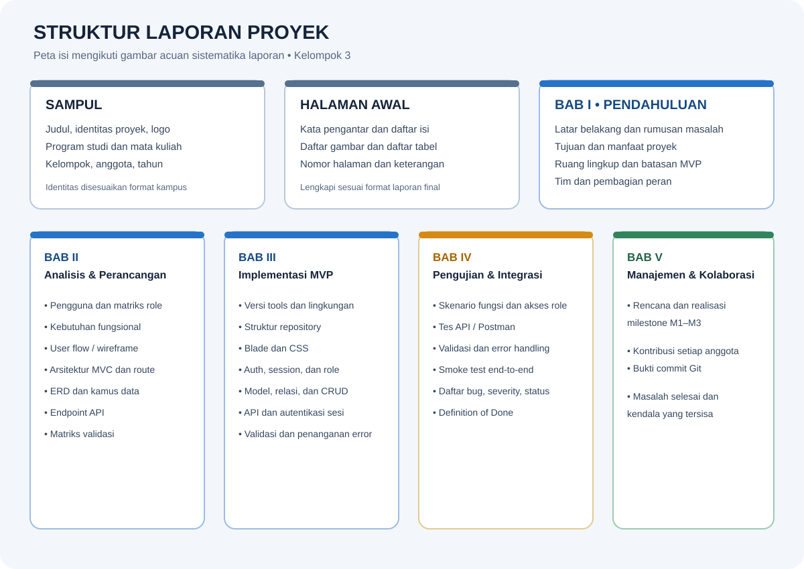
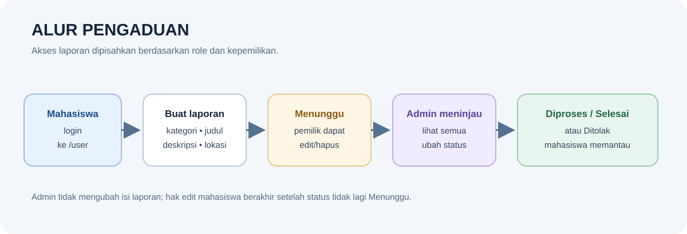
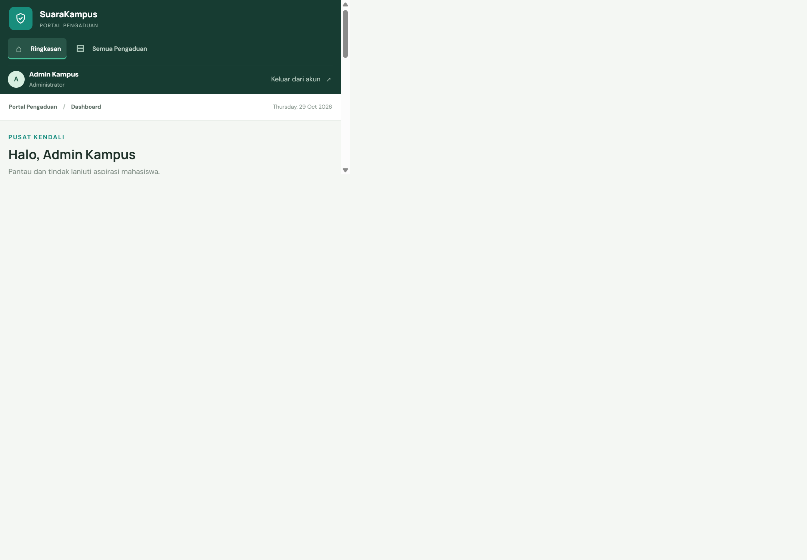
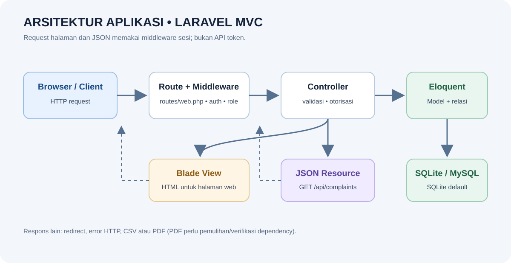
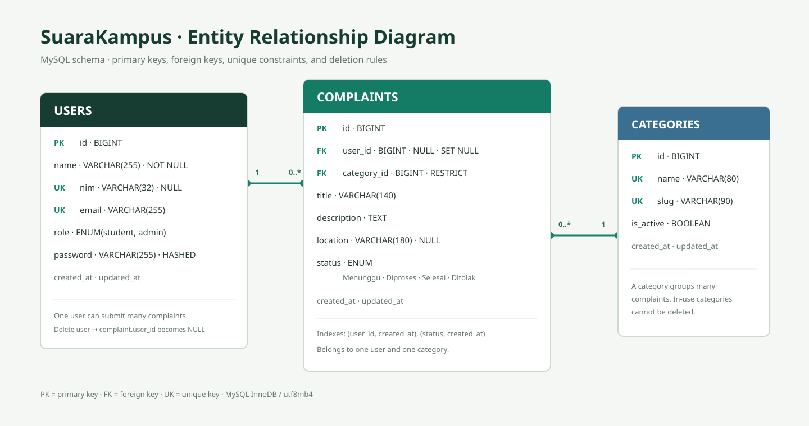
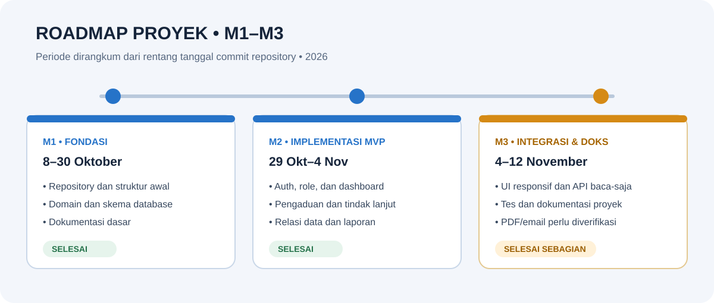

# Laporan Proyek Sistem Pengaduan Mahasiswa

**Kelompok 3 — Pemrograman Web Lanjut (INF3021)**  
**Disusun:** 12 November 2026  
**Status:** MVP web; beberapa integrasi dan verifikasi masih tertunda.

Laporan ini mengikuti sistematika pada gambar acuan: pendahuluan, analisis dan
perancangan, implementasi MVP, pengujian dan integrasi, serta manajemen proyek
dan kolaborasi. Rincian teknis lebih lanjut tersedia di
[panduan backend](./README.md), [panduan frontend](./frontend.md),
[panduan database](./database.md), [ERD](./ERD.md), dan
[laporan pengujian](./hasil-pengujian.md).

## BAB I — Pendahuluan

### 1.1 Latar Belakang

Pengaduan kampus perlu dicatat agar mahasiswa dapat menyampaikan masalah dan
memantau tindak lanjutnya. Sistem ini menyediakan portal untuk membuat dan
melihat laporan, sementara admin mengelola status serta meninjau seluruh
laporan.

### 1.2 Rumusan Masalah

1. Bagaimana menyediakan alur pencatatan pengaduan yang dapat dipantau?
2. Bagaimana membedakan akses mahasiswa dan admin pada data dan halaman?
3. Bagaimana menyajikan status, pencarian, serta rekap pengaduan?

### 1.3 Tujuan dan Manfaat

- Mencatat pengaduan dengan kategori, judul, deskripsi, dan lokasi opsional.
- Membantu mahasiswa melihat perkembangan laporan miliknya.
- Membantu admin meninjau laporan dan memperbarui status.
- Menyediakan dasar pengembangan berikutnya melalui data terstruktur, tes, dan
  dokumentasi.

### 1.4 Ruang Lingkup dan Batasan MVP

**Termasuk MVP:** registrasi/login, dashboard sesuai peran, CRUD pengaduan
mahasiswa dengan pembatasan status, pengelolaan status admin, pencarian,
pagination, profil/foto, manajemen akun mahasiswa, ekspor CSV/PDF, dan satu
endpoint JSON baca-saja.

**Batasan yang diketahui:** API hanya `GET /api/complaints`; tidak ada API token
atau endpoint tulis. SQLite adalah konfigurasi default, sedangkan MySQL belum
diverifikasi pada server. Pengiriman email reset kata sandi belum diuji melalui
layanan nyata. Tes unduhan PDF terakhir gagal karena facade DomPDF tidak
ditemukan di lingkungan pengujian. Pengujian visual browser/manual belum
dilaporkan selesai.

### 1.5 Tim dan Pembagian Peran

Pembagian peran mengikuti informasi anggota pada README proyek. Ringkasan
perubahan dan seluruh commit yang tercatat di GitHub ada pada
[BAB V](#bab-v--manajemen-proyek-dan-kolaborasi).

| Anggota | NIM | Peran yang dicatat |
|---|---:|---|
| Cantika Dwi Utari | 25170023 | Dokumentasi |
| Hafizh Zaidan Muttaqien | 25170006 | Backend |
| Naufal Marzuki Fadhil | 25170018 | Frontend |
| Paskalino Adrianus Warorowai (Pascal Ztecno) | 25170024 | Koordinator dan database |

## BAB II — Analisis dan Perancangan

### 2.1 Profil Pengguna dan Matriks Peran

| Kemampuan | Tamu | Mahasiswa | Admin |
|---|---:|---:|---:|
| Registrasi dan login | Ya | Ya | Ya |
| Membuat pengaduan | Tidak | Ya | Tidak |
| Melihat daftar/detail pengaduan | Tidak | Milik sendiri | Semua |
| Mengubah isi pengaduan | Tidak | Milik sendiri saat `Menunggu` | Tidak |
| Menghapus pengaduan | Tidak | Milik sendiri saat `Menunggu` | Ya |
| Mengubah status | Tidak | Tidak | Ya |
| Mengelola akun mahasiswa | Tidak | Tidak | Ya |
| Membaca API pengaduan | Tidak | Data sendiri | Semua data |

### 2.2 Kebutuhan Fungsional dan Nonfungsional

**Fungsional**

- Autentikasi mahasiswa dengan NIM/email dan autentikasi admin dengan email.
- Pembatasan route, query, dan tampilan sesuai peran.
- Pembuatan, pencarian, peninjauan, dan perubahan laporan sesuai matriks akses.
- Pengelolaan status laporan oleh admin dan rekap CSV/PDF.
- Respons JSON berhalaman untuk daftar pengaduan yang memerlukan sesi login.

**Nonfungsional**

- Validasi input dilakukan di server; password disimpan sebagai hash.
- Relasi tabel menggunakan foreign key dan indeks database.
- Halaman portal memiliki aturan CSS responsif; pengujian tampilannya tetap
  perlu dilakukan manual di browser.
- Kredensial demo hanya untuk pengembangan lokal, bukan produksi.

### 2.3 User Flow dan Referensi Tampilan

Diagram di bawah memperlihatkan alur utama; gambar dashboard adalah aset
referensi yang sudah ada di repository, bukan hasil tes visual terbaru.

### 2.4 Arsitektur MVC dan Peta Route

Halaman web dan endpoint JSON saat ini didefinisikan di `routes/web.php`.
Request melewati middleware, controller, model Eloquent, dan database. Respons
halaman dirender dengan Blade; endpoint API memakai resource JSON.

### 2.5 ERD dan Data

Entitas inti adalah `users`, `categories`, dan `complaints`. Satu user dan satu
kategori dapat berelasi dengan banyak pengaduan. Saat akun dihapus, `user_id`
pada laporan menjadi `NULL` agar laporan tidak ikut hilang; kategori yang masih
dipakai tidak dapat dihapus. Kamus kolom dan constraint tersedia di
[ERD dan kamus data](./ERD.md).

### 2.6 Endpoint API

| Method | Endpoint | Autentikasi | Perilaku |
|---|---|---|---|
| `GET` | `/api/complaints` | Sesi login Laravel | Mahasiswa menerima laporan sendiri; admin menerima semua. Mendukung `search` dan `page`; respons menggunakan `data`, `links`, dan `meta`. |

Endpoint ini baca-saja, bukan API berbasis token. Tamu yang meminta JSON tanpa
sesi login ditolak. Belum tersedia endpoint API untuk membuat, mengubah, atau
menghapus laporan.

### 2.7 Matriks Validasi Utama

| Data | Aturan yang terdokumentasi |
|---|---|
| Judul pengaduan | Wajib, 5–140 karakter |
| Deskripsi | Wajib, 10–3000 karakter |
| Lokasi | Opsional, maksimal 180 karakter |
| Kategori | Harus kategori aktif |
| Status | `Menunggu`, `Diproses`, `Selesai`, atau `Ditolak` |
| Foto profil | JPG/PNG/WEBP, maksimal 500 KB |
| Pagination API | Maksimal 10 laporan per halaman |

## BAB III — Implementasi MVP

### 3.1 Lingkungan dan Tools

| Komponen | Versi/konfigurasi |
|---|---|
| PHP runtime saat laporan dibuat | 8.5.12 |
| Laravel yang dilaporkan aplikasi | 13.39.0 |
| Composer pada lingkungan dokumentasi | 2.10.3 |
| Database default | SQLite |
| Database alternatif | MySQL, belum diuji dalam laporan pengujian |
| Antarmuka | Blade, HTML, CSS statis |

Versi runtime di atas adalah lingkungan dokumentasi, bukan klaim bahwa seluruh
versi PHP/Database telah diuji. Persyaratan setup dan konfigurasi lokal ada di
[README utama](../README.md) dan [panduan database](./database.md).

### 3.2 Struktur Repository

| Path | Isi |
|---|---|
| `app/` | Model, controller, resource API, policy, dan provider |
| `routes/` | Route web dan API |
| `database/` | Migration, factory, dan seeder |
| `resources/views/` | Halaman dan layout Blade |
| `public/css/` | CSS autentikasi dan portal |
| `tests/` | Tes feature dan unit |
| `docs/` | Panduan, diagram, screenshot, dan laporan proyek |

### 3.3 Layout Blade dan CSS

Antarmuka menggunakan template Blade dan CSS statis di `public/css/`. Project
tidak memakai Bootstrap atau frontend bundler dalam konfigurasi yang
terdokumentasi. Dashboard memiliki navigasi sesuai peran dan layout responsif;
uji visual pada ukuran perangkat nyata belum tercatat selesai.

### 3.4 Autentikasi, Sesi, dan Peran

Pengguna masuk dengan NIM/email dan kata sandi. Aplikasi memakai sesi Laravel
dan middleware/pemeriksaan peran. Login mengarahkan mahasiswa ke `/user` dan
admin ke `/admin`; tujuan redirect dashboard yang tidak sesuai peran diabaikan.
Pengiriman email pemulihan kata sandi belum diverifikasi melalui mail server.

### 3.5 Database, Model, Relasi, dan CRUD

Migration membangun tabel domain dan tabel pendukung Laravel. Model inti:
`User`, `Category`, dan `Complaint`. Mahasiswa membuat serta mengelola laporan
miliknya hanya selama status masih `Menunggu`; admin mengelola status dan akun
mahasiswa. Perincian aturan relasi ada di [panduan database](./database.md).

### 3.6 API dan Token

Endpoint daftar laporan JSON memerlukan **sesi login**, bukan bearer token/API
token. Mahasiswa hanya melihat laporan sendiri; admin dapat melihat semua.
Operasi API selain baca belum diimplementasikan.

### 3.7 Validasi, Pesan Error, dan Exception

Form web memakai validasi Laravel dan menampilkan pesan kesalahan pada halaman.
Route terlindungi membatasi tamu dan role yang tidak sesuai; halaman error 403
menyediakan navigasi kembali yang sesuai. Tes mencakup validasi input, status
akses, dan cakupan data. Daftar route dan contoh error API dijelaskan dalam
[panduan backend](./README.md).

## BAB IV — Pengujian dan Integrasi

### 4.1 Skenario Fungsional dan Hak Akses

Laporan eksekusi suite pada 11 November 2026 mencatat **86 tes, 85 lulus, dan
1 gagal (440 assertions)**. Tes mencakup autentikasi, role, CRUD, profil,
manajemen pengguna, laporan, dan API. Tes API terarah terakhir yang dicatat:
**6 lulus, 41 assertions**. Angka ini adalah hasil tercatat, bukan hasil
eksekusi ulang saat menyusun dokumen. Detail kasus ada di
[laporan pengujian](./hasil-pengujian.md).

### 4.2 Pengujian API

Tes otomatis menguji endpoint dengan sesi terautentikasi, batas data per role,
pencarian, urutan, dan pagination. Panduan [backend](./README.md) berisi cara
memanggil endpoint. Pengujian Postman/Collection Runner secara manual belum
tercatat; jangan menganggapnya sudah dijalankan.

### 4.3 Validasi dan Penanganan Error

Tes feature memeriksa validasi form dan pembatasan akses. Tes API memeriksa
request tanpa autentikasi dan bentuk hasil. Integrasi email nyata, browser, dan
server MySQL tidak termasuk bukti dari suite yang dilaporkan.

### 4.4 Smoke Test End-to-End

**Status: belum ada hasil smoke test manual yang tercatat.** Alur yang perlu
diverifikasi pada instalasi lokal:

1. Migrasi dan seed database lokal, lalu masuk sebagai mahasiswa.
2. Buat laporan, cari/buka laporan, dan pastikan laporan tidak muncul ke user
   mahasiswa lain.
3. Masuk sebagai admin, ubah status dan tinjau rekap.
4. Uji login/logout, profil, hak akses lintas-role, dan unduhan CSV/PDF.
5. Ulangi pengecekan UI pada desktop dan viewport ponsel.

### 4.5 Bug, Risiko, dan Definition of Done

**Perbaikan yang didukung oleh riwayat commit atau tes regresi**

| Masalah | Perbaikan/bukti | Status |
|---|---|---|
| Login bisa memakai tujuan redirect dashboard milik role lain. | Redirect diarahkan sesuai role; dicatat pada commit [`a526c7d`](https://github.com/pascalalshipa-ztprog/Kelompok-3/commit/a526c7d) dan dites untuk mahasiswa/admin. | Ditangani |
| Halaman 403 tidak memberi jalur kembali yang sesuai. | Tombol kembali ke dashboard ditambahkan pada [`a64cfef`](https://github.com/pascalalshipa-ztprog/Kelompok-3/commit/a64cfef) dan dipulihkan pada [`215a77e`](https://github.com/pascalalshipa-ztprog/Kelompok-3/commit/215a77e). | Ditangani |
| Akses data pengaduan harus dibatasi sesuai role dan pemilik. | Endpoint/API serta route role diuji dengan cakupan mahasiswa/admin; commit API [`1d64e46`](https://github.com/pascalalshipa-ztprog/Kelompok-3/commit/1d64e46). | Ditangani dan diuji |

Tidak ada GitHub Issue yang tercatat pada repository saat pemeriksaan. Tabel
ini mencatat perbaikan yang dapat ditelusuri dari commit/tes, bukan klaim bahwa
semua bug historis sudah diketahui.

**Kendala dan pekerjaan yang belum selesai**

| Kendala | Dampak | Tindak lanjut | Status |
|---|---|---|---|
| Tes unduh PDF gagal: `Barryvdh\DomPDF\Facade\Pdf` tidak ditemukan pada eksekusi yang dilaporkan. | Ekspor PDF belum lulus verifikasi runtime walaupun template dan tes ada. | Pulihkan dependency dengan `composer install`, jalankan tes PDF terarah, lalu suite penuh. | Terbuka |
| Email reset kata sandi belum diuji melalui layanan nyata. | Alur pengiriman email belum siap dinyatakan operasional. | Konfigurasi mail pada environment aman dan uji alur end-to-end. | Belum diverifikasi |
| MySQL belum diuji pada laporan pengujian. | Kompatibilitas lintas database belum terbukti. | Uji migration dan tes dengan database MySQL terisolasi. | Belum diverifikasi |
| Tes UI visual, Postman manual, dan smoke test belum tercatat. | Kualitas lintas browser/perangkat dan integrasi manual belum terkonfirmasi. | Jalankan checklist dan simpan hasil bertanggal. | Belum dilakukan |
| API hanya baca-saja dan PDF memuat data untuk dirender. | Operasi API tulis belum tersedia; volume besar dapat menambah kebutuhan memori PDF. | Tetapkan kontrak API bila diperlukan dan evaluasi ekspor pada data realistis. | Batasan MVP |

**Definition of Done untuk rilis MVP yang tervalidasi**

- Alur utama mahasiswa/admin lulus tes fungsional dan uji akses.
- Ekspor CSV dan PDF berhasil pada environment yang didukung.
- Migration berjalan pada database target yang dipilih.
- Smoke test manual serta pemeriksaan viewport desktop/mobile dicatat.
- Dokumentasi menyebut batasan dan versi/environment hasil verifikasi.

## BAB V — Manajemen Proyek dan Kolaborasi

### 5.1 Rencana dan Realisasi Milestone M1–M3

Periode di bawah dirangkum dari rentang tanggal commit repository; bukan jadwal
resmi yang memiliki bukti persetujuan terpisah.

| Milestone | Periode jejak commit | Target | Realisasi dan status |
|---|---|---|---|
| **M1 — Fondasi dan kebutuhan MVP** | 8–30 Oktober 2026 | Membuat repository, menentukan domain pengaduan, menata struktur awal dan database. | Project awal, file database, dan dokumentasi dasar tercatat. **Selesai untuk fondasi.** |
| **M2 — Implementasi MVP** | 29 Oktober–4 November 2026 | Membangun autentikasi, role, model/relasi, pengaduan, dashboard, serta alur admin. | Fitur inti dan pemisahan dashboard/route berkembang dalam commit backend. **Selesai untuk cakupan MVP yang tercatat.** |
| **M3 — Integrasi, pengujian, dan dokumentasi** | 4–12 November 2026 | Menyempurnakan UI, akses/API, uji regresi, dan dokumentasi akhir. | UI responsif, API baca-saja, perbaikan role, dan dokumentasi tercatat. PDF gagal dalam tes terakhir; email/MySQL/UI manual belum diverifikasi. **Selesai sebagian.** |

### 5.2 Kontribusi Anggota dan Bukti Git

Tabel berikut memuat **34 commit yang dikembalikan GitHub untuk riwayat
repository saat dokumentasi disusun**, termasuk merge dan commit pemeliharaan.
Commit merge/pemeliharaan tidak selalu mewakili perubahan fitur tersendiri.
Tidak ada issue tracker GitHub yang menghubungkan commit tersebut ke nomor
issue, sehingga ringkasan masalah diambil dari subjek commit dan bukti tes.

#### Ringkasan kontribusi per anggota

| Anggota | Akun GitHub | Kontribusi/masalah yang ditangani |
|---|---|---|
| Cantika Dwi Utari | [@cantikadwiutari7-cell](https://github.com/cantikadwiutari7-cell) | Menata informasi proyek/anggota dan dokumentasi; mengintegrasikan perubahan dokumentasi. |
| Hafizh Zaidan Muttaqien | [@FizZaidan](https://github.com/FizZaidan) | Mengembangkan API pengaduan baca-saja dengan cakupan akses berdasarkan role, route role, dan dashboard; sinkronisasi backend. |
| Naufal Marzuki Fadhil | [@naufalmarzukifadhil](https://github.com/naufalmarzukifadhil) | Memperbaiki layout responsif, dashboard role, URL user, dan navigasi halaman 403. |
| Paskalino Adrianus Warorowai (Pascal Ztecno) | [@pascalalshipa-ztprog](https://github.com/pascalalshipa-ztprog) | Menyiapkan proyek/database dan dokumentasi, memperbarui backend, serta memperbaiki redirect sesuai role. Sebagian commit historis tidak tertaut langsung ke akun GitHub oleh metadata author. |

#### Daftar semua commit yang terlihat di GitHub

| Anggota | Akun | Commit | Perubahan atau masalah yang ditangani menurut pesan commit |
|---|---|---|---|
| Cantika Dwi Utari | `cantikadwiutari7-cell` | [`964ef24`](https://github.com/pascalalshipa-ztprog/Kelompok-3/commit/964ef24) | Merge pull request dokumentasi. |
| Cantika Dwi Utari | `cantikadwiutari7-cell` | [`a2aa741`](https://github.com/pascalalshipa-ztprog/Kelompok-3/commit/a2aa741) | Menyelesaikan tugas dokumentasi. |
| Hafizh Zaidan Muttaqien | `FizZaidan` | [`20e3e1f`](https://github.com/pascalalshipa-ztprog/Kelompok-3/commit/20e3e1f) | Sinkronisasi API dan pembaruan backend. |
| Naufal Marzuki Fadhil | `naufalmarzukifadhil` | [`93d7a93`](https://github.com/pascalalshipa-ztprog/Kelompok-3/commit/93d7a93) | Meningkatkan tampilan responsif portal pengaduan. |
| Naufal Marzuki Fadhil | `naufalmarzukifadhil` | [`887f969`](https://github.com/pascalalshipa-ztprog/Kelompok-3/commit/887f969) | Meningkatkan tampilan responsif portal pengaduan. |
| Hafizh Zaidan Muttaqien | `FizZaidan` | [`bf0d540`](https://github.com/pascalalshipa-ztprog/Kelompok-3/commit/bf0d540) | Merge branch backend. |
| Hafizh Zaidan Muttaqien | `FizZaidan` | [`23f0ad5`](https://github.com/pascalalshipa-ztprog/Kelompok-3/commit/23f0ad5) | Memisahkan route berdasarkan role dan meningkatkan dashboard. |
| Cantika Dwi Utari | `cantikadwiutari7-cell` | [`4af2987`](https://github.com/pascalalshipa-ztprog/Kelompok-3/commit/4af2987) | Menata informasi proyek dan anggota di README. |
| Hafizh Zaidan Muttaqien | `FizZaidan` | [`1d64e46`](https://github.com/pascalalshipa-ztprog/Kelompok-3/commit/1d64e46) | Menambah akses API baca-saja sesuai role user/admin. |
| Paskalino Adrianus Warorowai | `pascalalshipa-ztprog` | [`a526c7d`](https://github.com/pascalalshipa-ztprog/Kelompok-3/commit/a526c7d) | Memperbaiki redirect login agar sesuai role. |
| Cantika Dwi Utari | `cantikadwiutari7-cell` | [`a758469`](https://github.com/pascalalshipa-ztprog/Kelompok-3/commit/a758469) | Merge pull request dokumentasi. |
| Cantika Dwi Utari | `cantikadwiutari7-cell` | [`b397739`](https://github.com/pascalalshipa-ztprog/Kelompok-3/commit/b397739) | Mengirim perubahan branch dokumentasi. |
| Naufal Marzuki Fadhil | `naufalmarzukifadhil` | [`a45905a`](https://github.com/pascalalshipa-ztprog/Kelompok-3/commit/a45905a) | Merge branch frontend. |
| Naufal Marzuki Fadhil | `naufalmarzukifadhil` | [`41c1463`](https://github.com/pascalalshipa-ztprog/Kelompok-3/commit/41c1463) | Sinkronisasi branch frontend dengan branch asal. |
| Naufal Marzuki Fadhil | `naufalmarzukifadhil` | [`dc17cbb`](https://github.com/pascalalshipa-ztprog/Kelompok-3/commit/dc17cbb) | Mengubah URL user. |
| Naufal Marzuki Fadhil | `naufalmarzukifadhil` | [`215a77e`](https://github.com/pascalalshipa-ztprog/Kelompok-3/commit/215a77e) | Memulihkan halaman 403. |
| Paskalino Adrianus Warorowai | `pascalalshipa-ztprog` | [`1a39d86`](https://github.com/pascalalshipa-ztprog/Kelompok-3/commit/1a39d86) | Merge branch backend. |
| Paskalino Adrianus Warorowai | `pascalalshipa-ztprog` | [`4d282ca`](https://github.com/pascalalshipa-ztprog/Kelompok-3/commit/4d282ca) | Memperbarui backend. |
| Naufal Marzuki Fadhil | `naufalmarzukifadhil` | [`a64cfef`](https://github.com/pascalalshipa-ztprog/Kelompok-3/commit/a64cfef) | Menambahkan tombol kembali ke dashboard pada error 403. |
| Naufal Marzuki Fadhil | `naufalmarzukifadhil` | [`fa1cace`](https://github.com/pascalalshipa-ztprog/Kelompok-3/commit/fa1cace) | Memisahkan dashboard admin dan user. |
| Paskalino Adrianus Warorowai | `pascalalshipa-ztprog` | [`130d3dd`](https://github.com/pascalalshipa-ztprog/Kelompok-3/commit/130d3dd) | Menambahkan berkas ke folder dokumentasi. |
| Paskalino Adrianus Warorowai | `pascalalshipa-ztprog` | [`cac8887`](https://github.com/pascalalshipa-ztprog/Kelompok-3/commit/cac8887) | Memperbarui README. |
| Paskalino Adrianus Warorowai | `pascalalshipa-ztprog` | [`dfcd4eb`](https://github.com/pascalalshipa-ztprog/Kelompok-3/commit/dfcd4eb) | Memperbarui folder dan kode. |
| Paskalino Adrianus Warorowai | `pascalalshipa-ztprog` | [`a069db3`](https://github.com/pascalalshipa-ztprog/Kelompok-3/commit/a069db3) | Merge branch utama. |
| Paskalino Adrianus Warorowai | `pascalalshipa-ztprog` | [`b6d8ac4`](https://github.com/pascalalshipa-ztprog/Kelompok-3/commit/b6d8ac4) | Memperbaiki konflik README. |
| Paskalino Adrianus Warorowai | `pascalalshipa-ztprog` | [`a02122f`](https://github.com/pascalalshipa-ztprog/Kelompok-3/commit/a02122f) | Mengunggah project dan file database SQL. |
| Paskalino Adrianus Warorowai | `pascalalshipa-ztprog` | [`a1f7343`](https://github.com/pascalalshipa-ztprog/Kelompok-3/commit/a1f7343) | Memperbarui README dan menambahkan direktori docs/src. |
| Paskalino Adrianus Warorowai | `pascalalshipa-ztprog` | [`7907e86`](https://github.com/pascalalshipa-ztprog/Kelompok-3/commit/7907e86) | Menyelesaikan konflik akibat penghapusan README. |
| Paskalino Adrianus Warorowai | `pascalalshipa-ztprog` | [`5875cd2`](https://github.com/pascalalshipa-ztprog/Kelompok-3/commit/5875cd2) | Sinkronisasi penghapusan berkas. |
| Paskalino Adrianus Warorowai | `pascalalshipa-ztprog` | [`36e8ee2`](https://github.com/pascalalshipa-ztprog/Kelompok-3/commit/36e8ee2) | Menghapus `read.md`. |
| Paskalino Adrianus Warorowai | `pascalalshipa-ztprog` | [`360e865`](https://github.com/pascalalshipa-ztprog/Kelompok-3/commit/360e865) | Menghapus README pada commit tersebut. |
| Paskalino Adrianus Warorowai | `pascalalshipa-ztprog` | [`0a94619`](https://github.com/pascalalshipa-ztprog/Kelompok-3/commit/0a94619) | Merge branch utama. |
| Paskalino Adrianus Warorowai | `pascalalshipa-ztprog` | [`16fd7a6`](https://github.com/pascalalshipa-ztprog/Kelompok-3/commit/16fd7a6) | Commit awal project. |
| Paskalino Adrianus Warorowai | `pascalalshipa-ztprog` | [`cbd7ce8`](https://github.com/pascalalshipa-ztprog/Kelompok-3/commit/cbd7ce8) | Initial commit. |

Daftar commit adalah bukti perubahan repository, bukan bukti bahwa seluruh fitur
berhasil dijalankan di production. Status verifikasi dan kendala yang diketahui
ditampilkan terpisah pada [BAB IV](#bab-iv--pengujian-dan-integrasi).
